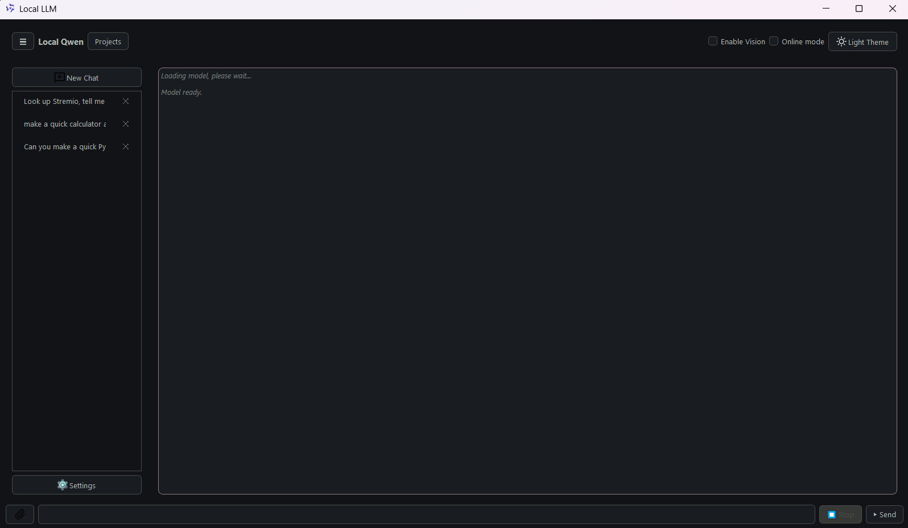
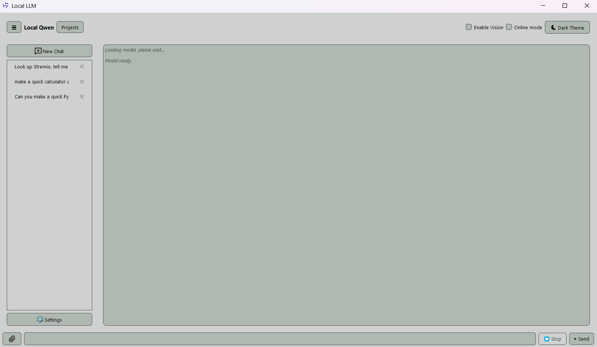
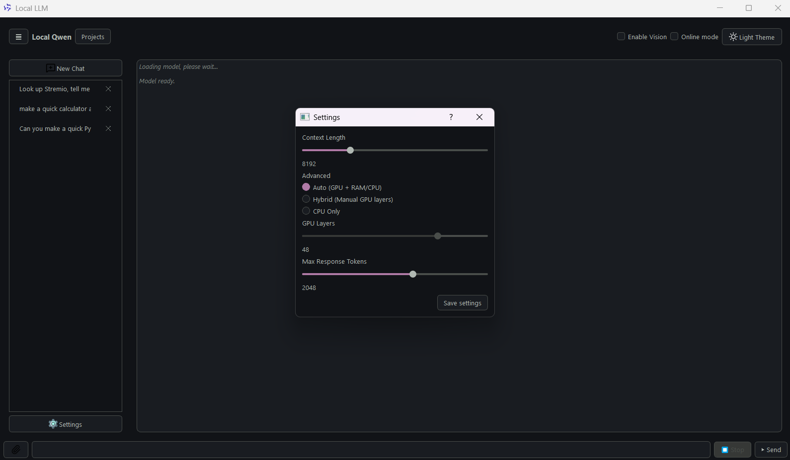
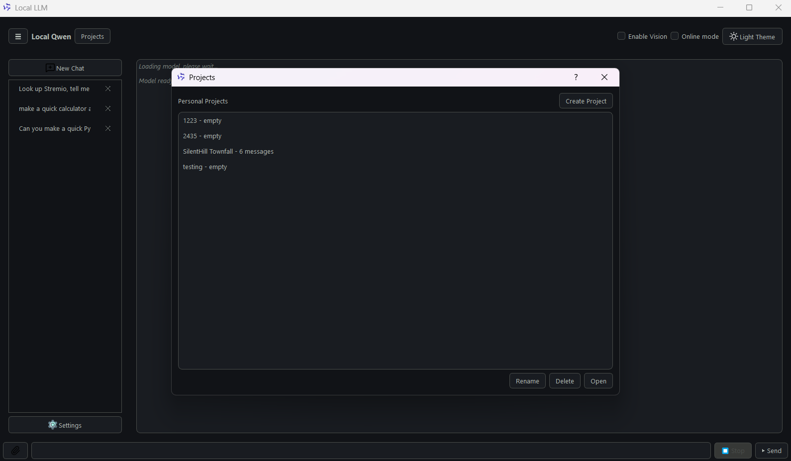
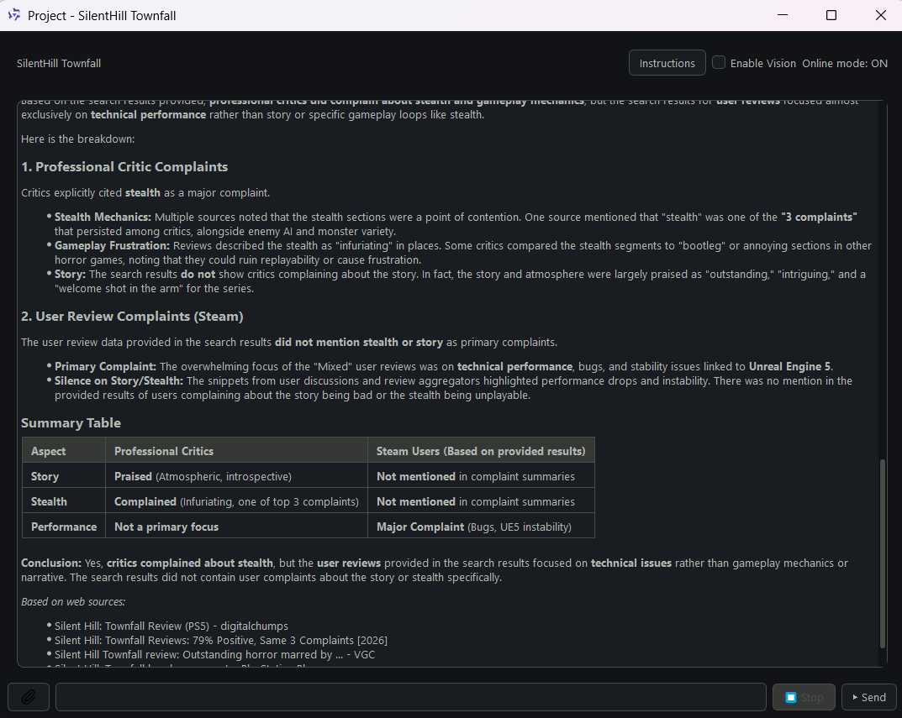
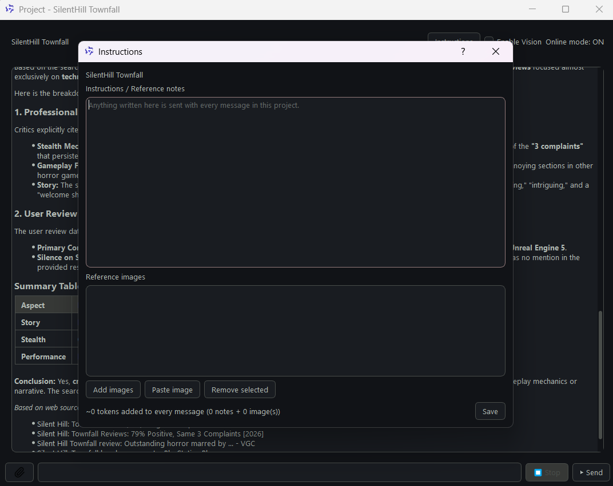

## -- Local Qwen --
A Windows desktop chat app that runs Qwen3.6-27B entirely on your own PC through llama.cpp, with optional private web search through a self-hosted SearXNG instance.

No accounts, no API keys, no cloud. Your chats stay in a folder on your drive.

Below are some screenshots of the final app:







## Features
- Fully local - the model runs on your GPU through llama-server from llama.cpp.
- Online mode (optional) - private web search through SearXNG running in Docker. The model turns your message into a search query, answers from the results and lists its sources under the reply.
- Vision - attach or paste (Ctrl+V) images and ask about them. Image reading only, no image generation.
- File attachments - PDF, Word (.docx), Excel (.xlsx), CSV, code and plain text files.
- Projects - separate conversations, each with its own instructions, notes and reference images that are sent with every message in that project.
- Proper formatting - Markdown with syntax-highlighted code blocks, tables and lists.
- Dark and light themes
- Adjustable settings - context length, GPU/CPU placement and response length, with built-in help behind the ? button.

## -- Hardware --
The app and model choice are tuned for an NVIDIA RTX 5070 (12 GB VRAM):

## -- Components --
Qwen3.6-27B, UD-IQ3_XXS quant (~10.5GB)
Vision projector (mmproj-F16) (~1.1GB)

Cards with similar or more VRAM (RTX 4070 Ti, RTX 5060 Ti 16 GB, RTX 4080 and up) work the same way. More VRAM lets you use a longer context and vision without slowing down. With less VRAM, part of the model moves to system RAM and the CPU, and generation gets much slower.
On the RTX 5070 used for development, generation runs at roughly 10-12 tokens per second in Auto mode with vision off.

## -- Requirements --
- Windows 10 or 11
- NVIDIA GPU with an up-to-date driver
- Docker Desktop (Only for Online mode)
- Python 3.11 or newer (Only if you run from source instead of the .exe)

## -- Setup --
## 1. Get the app
#### Clone the repository (or download it as a ZIP):
```bash
git clone https://github.com/<your-username>/<repo-name>.git
```
## 2. Download llama.cpp
- Download the Windows CUDA build (`llama-<version>-bin-win-cuda-<cuda-version>-x64.zip`) and the matching
CUDA runtime (`cudart-...-x64.zip`). RTX 50-series cards need a CUDA 12.8 or newer build.

- Extract both into LocalLLM\backend_13.3\, so that the file exists:
LocalLLM\backend_13.3\llama-server.exe

## 3. Download the models
From unsloth/Qwen3.6-27B-GGUF on Hugging Face, download these two files into LocalLLM\models\:
- Qwen3.6-27B-UD-IQ3_XXS.gguf - the language model
- mmproj-F16.gguf - the vision projector (optional, without it, Enable vision stays grayed out)

#### Your folder should look like this:
```text
LocalQwen.exe
Icons-Pictures\
SearXNG\
docker-compose.yml
LocalLLM\
    backend_13.3\
        llama-server.exe
        ...
    models\
        Qwen3.6-27B-UD-IQ3_XXS.gguf
        mmproj-F16.gguf
```

## 4. Set up SearXNG (Only for Online mode)
- Install Docker Desktop and start it.
- Open a terminal in the SearXNG folder and run:
```bash
docker compose up -d
```

The first start downloads the images and creates SearXNG\searxng\settings.yml.
Give it about 30 seconds and open settings.yml, find formats: under search: and add json:
```bash
search:
     formats:
       - html
       - json
```

Without this, every earch fails with 403 Forbidden.

From now on the app starts and stops SearXNG by itself when you tick Online mode.
Docker Desktop just has to be running.

## -- Running --
### Option A: the executable
Download LocalQwen.exe from the Releases page (or build it yourself), put it in the main folder next to LocalLLM and double click it.

### Option B: from source
```bash
pip install -r requirements.txt
python main.py
```

## -- Using the app --
- First start - loading the model takes a while. Wait for Model ready in the chat before sending.
- Enable Vision - restarts the model with the vision projector loaded. It uses about 1.1 GB more VRAM and makes text generation slower, so leave it off when you don't need images.
- Online mode - each message shows the search query it used (Searching: ...), and the sources are listed under the answer.
- Projects - click Projects, create one, then use Instructions to add notes and reference images the model sees with every message in that project. Each reference image costs about 1,100 tokens of context per message.
- Settings - the ? button in the title bar explains every option. Settings reset when you close the app.
- Troubleshooting - the model server's output is written to llama-server.log in the app folder.

## -- Building the executable --
### pip install pyinstaller
### pyinstaller --onefile --windowed --name LocalQwen --icon Icons-Pictures\Qwen_logo.png main.py

The result is in dist\LocalQwen.exe, cut the exe and move it in the main folder before running it.

The .exe contains only the app itself. The models, llama.cpp and SearXNG stay in their own folders next to it.

## -- Privacy --
The model runs on your machine. Nothing you type is sent anywhere unless Online mode is on.
Chats are saved as JSON in chats\ and projects in projects\. Both are excluded from Git.
In Online mode, only the search query leaves your PC. Your own SearXNG instance sends it to the search engines, which see the query and your IP address, but no account or tracking cookies.

If you wish to run a different model, you will have to do a few modifications to the files.

## -- Built with -- 
- PyQt5 - user interface
- llama.cpp - model server
- Qwen3.6-27B by the Qwen team, GGUF quantization by Unsloth
- SearXNG - private metasearch engine
- Python-Markdown and Pygments - formatting and code highlighting
- pypdf, python-docx, openpyxl and Pillow - reading attachments